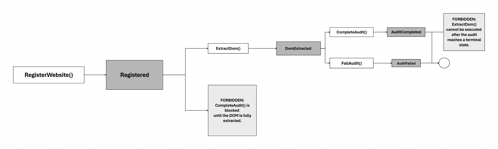

# Tactical Design: Lifecycles, Invariants & TDD

## I. Aggregate Lifecycle Diagram (Project Audit)



## II. Catalog of Core Business Invariants

| Aggregate Root | Domain Invariant | Exception |
| :--- | :--- | :--- |
| **Project** | Registration requires a correctly formatted URL structure (scheme presence). | `InvalidWebsiteUrlException` |
| **Project** | System cannot downgrade or upgrade to non-existent WCAG parameters (e.g., "3.0"). | `UnsupportedWcagVersionException` |
| **AuditScope** | Domain logic prohibits the initialization of a scope with an empty DOM string. | `EmptyDomException` |
| **Subscription** | A subscription remains inactive if the payment gateway transaction is declined. | `CardDeclinedException` |
| **Project** | Any operation tied to a specific project strictly requires that project to exist in the database. | `ProjectNotFoundException` |

## III. Behavior-Driven Specifications (TDD Scenarios)

### Happy Paths (Positive)

> **Scenario: Successful Project Registration**
> * **Given** an input URL `"https://example.com"`
> * **When** the project registration command is executed
> * **Then** a new Project is instantiated, an ID is generated, and the domain event `AddedAProject` is raised.

> **Scenario: Successful Subscription Activation**
> * **Given** a new user `Subscription` in a pending/inactive state
> * **When** a payment is processed with a positive gateway response
> * **Then** the subscription's state transitions to active (`IsActive = true`).

### Edge Cases (Negative)

> **Scenario: Guarding against empty DOM structures**
> * **Given** a valid Project ID but a null/empty string for the extracted DOM
> * **When** the system attempts to create an `AuditScope`
> * **Then** the creation is halted, state remains unchanged, and `EmptyDomException` is thrown.

> **Scenario: Blocking unsupported compliance standards**
> * **Given** a valid, registered `Project`
> * **When** a command attempts to set the audit standard to `"3.0"`
> * **Then** the aggregate instantly rejects the command via `UnsupportedWcagVersionException` without emitting any events.

## IV. Applied GoF Design Pattern

**Pattern:** `Strategy` (Domain Policy)

**Context:** The `AuditAndCompliance` domain uses the Strategy pattern to encapsulate variable WCAG scoring algorithms. Instead of cluttering the aggregate with conditional logic for versions 2.0, 2.1, and 2.2, a dedicated policy interface is injected to handle the calculations.

```csharp
public interface IWcagScoringPolicy
{
    bool IsApplicable(WcagVersion version);
    AuditScore CalculateScore(ParsedDom elements);
}
```